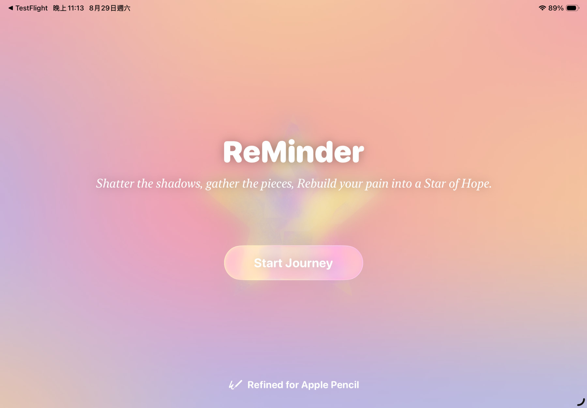
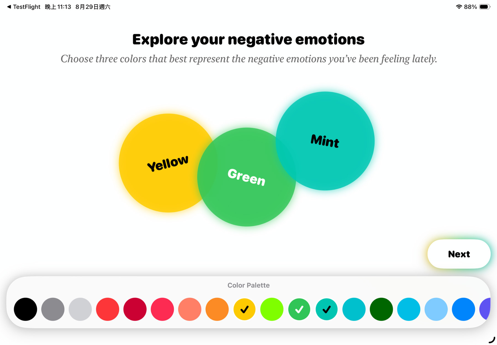
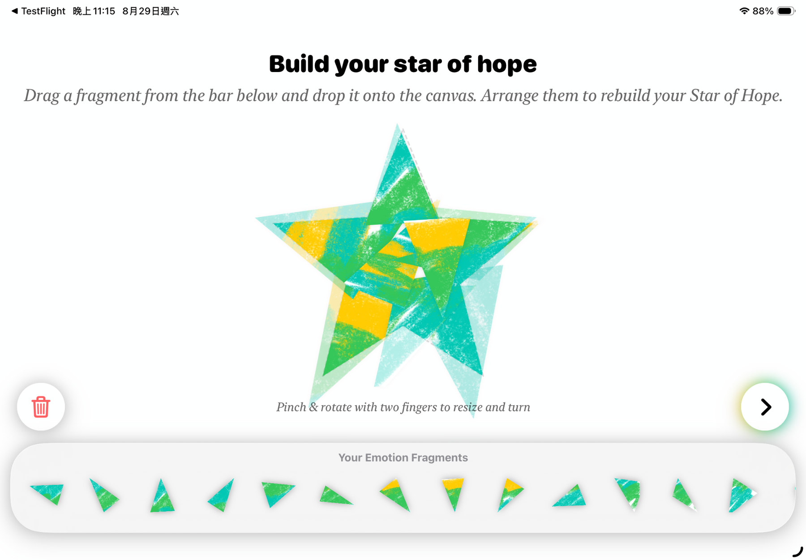
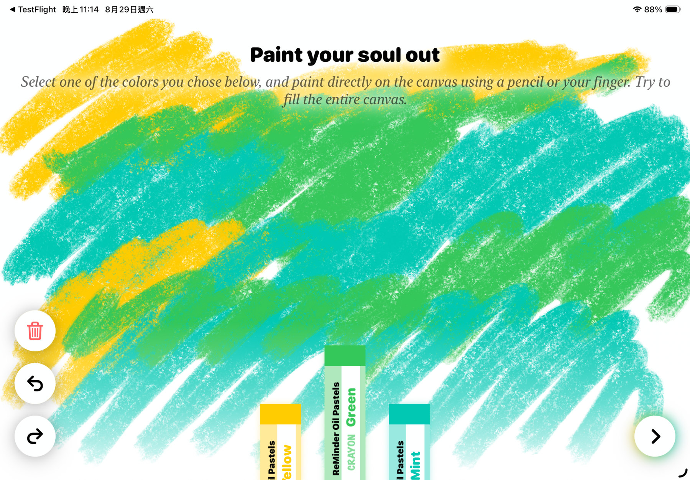
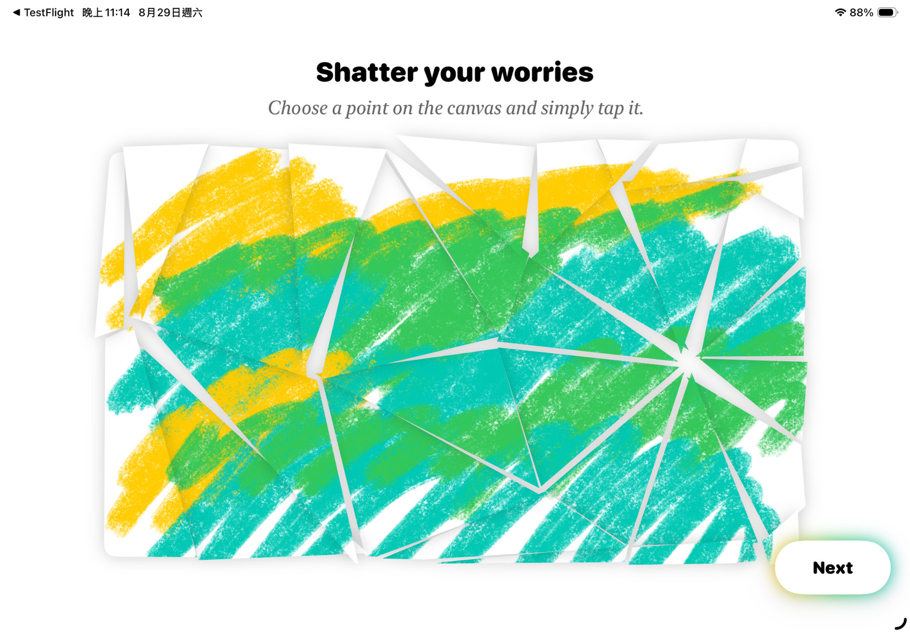

# The Birth of ReMinder: From Inspiration to Creation

> This is the first part of my SSC26 story, about how ReMinder went from an idea to a design to a working app. For the award and my WWDC26 experience, see [Part 2](/stories/ssc26-reminder-part-2).

## About ReMinder

ReMinder is a project focused on emotional healing and self-exploration. It was inspired by a workshop I once attended at the student counseling center of National Taipei University of Nursing and Health Sciences.

Through a five-stage art experience redesigned specifically for iPad—Notice, Release, Break, Rebuild, and Transcend—ReMinder gently encourages people to face and explore their emotions. It also uses easy-to-learn, calming interactions to reduce frustration along the way and to leave a sense of accomplishment at the end. I want people to discover that, beyond their emotions, they're still capable of finishing something small—helping them feel empowered and regain a sense of control.

I also hope the idea behind ReMinder—"behind stress and difficult emotions, there may also be hope"—can encourage people to rediscover their passion for life.

As for the name, it hides the kind of pun Taiwanese people love (haha). It's both "Remind" and "Re-Mind." When someone is overwhelmed by their emotions, I hope ReMinder lives up to its name: offering a gentle reminder, and helping them rethink how they see their feelings.

The name did cause me a small problem when publishing to the App Store, though. When I tried to use "ReMinder" in App Store Connect, the system wouldn't accept it—probably because it's so close to Apple's own Reminders app. In the end, I added "Edition" to the name before it could go live.

But looking at it another way, that accidental "Edition" also works nicely as a once-in-a-lifetime commemorative edition for this Swift Student Challenge win!

## How Did I Come Up With the Idea?

2026 was my first time entering the Swift Student Challenge. Funnily enough, I only found out about it because I'd contacted Apple Support to ask whether university students could still get a free Apple Developer account. (Though that's probably not the point.)

But the truly hard part was only just beginning.

Since it was my first time competing, I had almost no experience, and just choosing a topic already had me racking my brain. The project had to run offline, stay under 25 MB, and be fully experienced by the judges within three minutes—while also covering innovation, creativity, social impact, and inclusivity. For me back then, that was really, really hard.

To keep my thinking from drifting in every direction, I set myself a goal for the submission first: it had to reflect who I am, and it had to be something unique.

So I started looking for inspiration in everyday life—my own interests and frustrations, personal experiences, the thoughts of friends and family, and the social issues I usually pay attention to. During that time, the two questions I asked myself most often were:

> "Why do I want to make this? What can it bring to people?"
> "Why is this a topic that only I can make, and only I can tell?"

One afternoon, I suddenly remembered a counseling center workshop I'd attended in my first year of university. The warm-up activity was an art experience using crayons and paper: participants first chose crayon colors close to their current feelings and scribbled freely on the paper, then tore the drawing apart, and finally used the pieces to put together a calm picture they imagined in their minds. It was a simple activity, but the whole process felt deeply healing.

The complexity and length of that experience seemed like a great fit for a Swift Student Challenge project. More importantly, it wasn't just something I'd found online—it was an experience I had taken part in and felt for myself.

With that, I decided to use the workshop as my starting point, redesign the original art experience as an interactive piece for iPad, and start building it in Swift Playgrounds.

## The Making Process and the Problems I Ran Into

Before preparing for this challenge, I had never touched Swift at all. Although I had experience with other programming languages, learning a new one in a short time still took a lot of time and effort, so I relied on AI for help in many parts of building ReMinder.

To make things harder, because I was developing on an iPad, I couldn't use the agentic coding tools I was more familiar with. I could only copy and paste back and forth with AI—checking code, fixing errors, and running tests again, over and over. It was much more exhausting than I expected, and for a while I genuinely thought about giving up. Luckily, I quickly talked myself out of it, or there wouldn't be any story to tell. All I can say is that on the day I finally saw the result, all the effort felt worth it. (Tears.)

Back to the design itself: I knew very well that my strength wasn't fancy algorithms. So instead of chasing technical complexity, I put more of my energy into the user experience and flow—how to let people finish the whole experience within three minutes, how each screen should be arranged, and whether each interaction really conveyed the feeling I wanted.

I focused my design thinking on three main directions.

### 1. Reducing Cognitive Load and Frustration

ReMinder is an app built around healing. If people had to work hard to understand the interface, hunt for features, or got annoyed because something didn't work smoothly, the project would lose its whole purpose.

So I removed as many unnecessary elements from the screen as I could, used conversational, easy-to-understand guidance, and kept testing and refining the interactions to make the experience feel intuitive and natural. My goal was that people wouldn't have to think much about "what do I do next," and could focus on their own emotions and creation instead.

### 2. Keeping the Experience Complete Within the Time Limit

The original art activity at the counseling center took about 15 minutes, but the Swift Student Challenge required that the project could be experienced within three minutes. That meant I couldn't simply move the original flow onto an iPad—I had to rethink which steps could be simplified and which experiences couldn't be left out.

After analyzing the original activity, I found that much of the time was spent thinking and assembling the collage, so I adjusted that part: instead of free-form collage, people cut pieces using a fixed star-shaped mold. They just drag a fragment onto the screen to preview the cut, then, with a few simple steps, piece the fragments together into a personal postcard with a message and the date. This not only shortens the time needed, but also keeps the core idea of "putting broken things back together."

### 3. Reimagining the Materials From the Physical Activity

This is the part I personally found most interesting, and the one I spent the most time thinking about.

The original workshop used crayons and paper. Apple's PencilKit can already simulate drawing quite convincingly on iPad, but the feel of paper itself—especially tearing it apart with your own hands—is hard to recreate on a screen.

I did consider letting people draw lines with a finger to simulate cutting or tearing paper, but after testing it, something always felt missing. It didn't feel like really tearing paper, and I didn't think that interaction could bring the same healing feeling as the original activity. So I started asking myself:

> If it's so hard to recreate paper on an iPad, why does it have to be paper?
> Is there another material that would work better on an iPad?

Thinking it over, I remembered Liquid Glass, the new design language Apple introduced with its 26 operating systems. And the material "glass" suddenly sparked an idea: glass... glass... GLASS! Why not redesign the original paper canvas as a sheet of glass? The original activity used "tearing paper" to symbolize emotions breaking down; in ReMinder, I could use "shattering glass" instead, as if people were holding a little hammer and breaking the canvas that carries their emotions with their own hands.

After testing it, I found the glass-style design was far more striking than simulated paper tearing—in visual tension, interactive feedback, and overall impact. In the end, I dropped paper and made glass ReMinder's main canvas. It was one of the design trade-offs from the whole process that left the deepest impression on me.

### Looking Back: AI Can Help Write Code, but the Decisions Are Still Yours

Looking back on this project, I found that most of my time wasn't spent on programming, but on repeatedly refining the UI/UX and the overall flow. With AI's help, writing code and fixing bugs weren't the biggest challenges for me—but that doesn't mean building the project became easy.

AI can help me write code, debug, and even suggest design ideas. But how should a screen look? What makes a flow feel smooth? What kind of interaction helps people relax? And how do you reinterpret a physical art experience as something that works on iPad? None of these questions have a single right answer.

Even when AI offers all kinds of options, I still have to decide which design best fits the original idea, and whether people can actually feel what I want to convey when they use it. Those decisions don't come from just thinking about them, either. Most of the time, I only found a better approach after trying things, discovering problems, throwing out my original ideas, and adjusting again.

For me, one of the biggest rewards of this challenge was exactly that process of thinking, trial and error, and making design decisions. More than simply learning a new programming language, I learned how to turn an idea that only existed in my head, step by step, into something other people can actually experience.

## Little Easter Eggs Hidden in ReMinder

Beyond the designs above, I also quietly hid a few little Easter eggs in ReMinder. As for where they are and what they mean, I'll keep that a secret for now—I'd love for curious users to discover them for themselves!

I believe art doesn't have a single correct answer. Even the same image can bring different thoughts and feelings to different people. When I designed these Easter eggs, I had my own ideas in mind, but that doesn't mean people have to read them the way I intended. Maybe someone will come up with an interpretation I never even thought of—and that would be fun too.

***

As for what happened after I submitted the project? I'll save that for [Part 2](/stories/ssc26-reminder-part-2)!

## Try ReMinder

If you'd like to experience this journey from exploring your emotions to piecing hope back together, download ReMinder and try creating a star of hope of your own.

[Try ReMinder on the App Store](https://apps.apple.com/app/reminder-edition/id6790437560)
