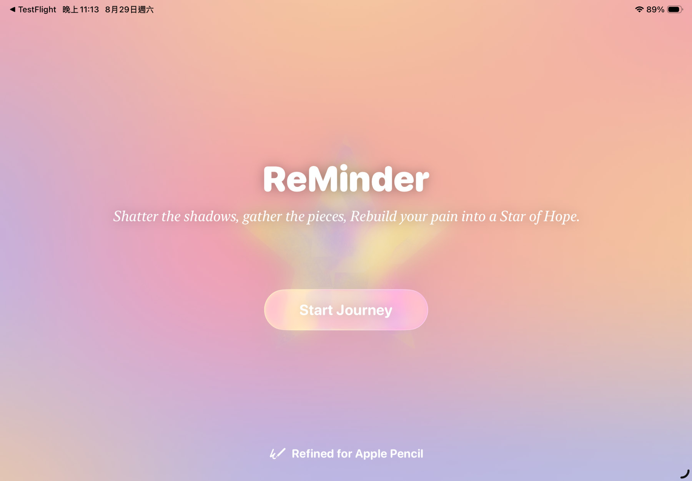
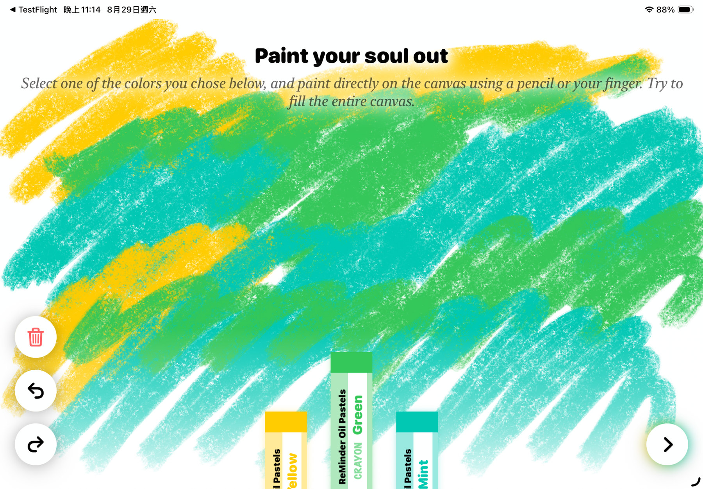
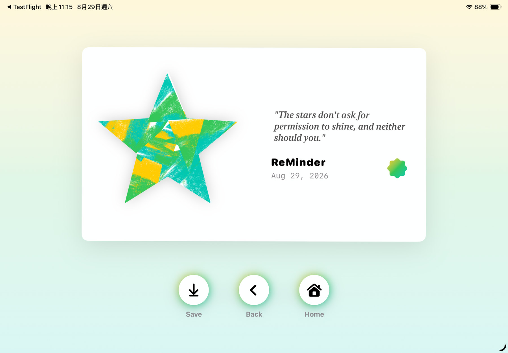
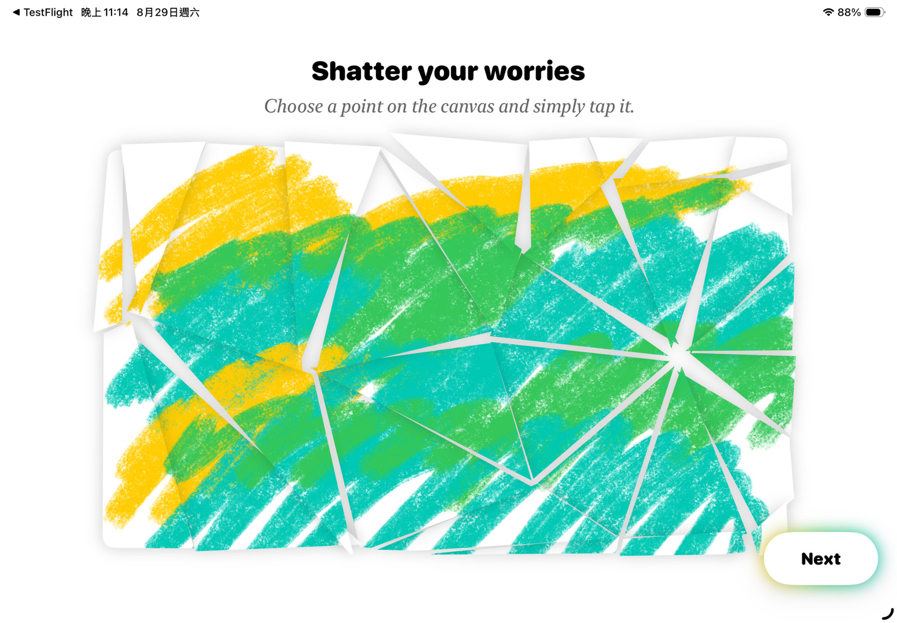
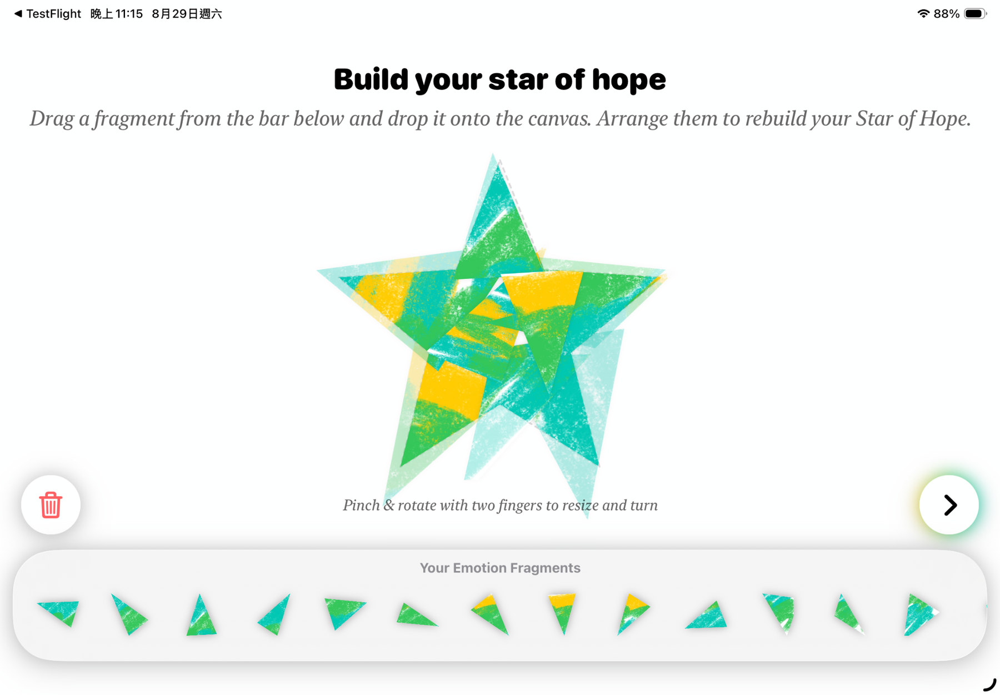

# ReMinder 的誕生—從靈感到作品

> 這是 SSC26 分享的上篇，聊聊 ReMinder 這個作品從靈感、設計到開發的過程。得獎與 WWDC26 的經歷，請看下篇。

## 作品介紹

ReMinder 是一個專注於心靈療癒與自我探索的作品，靈感來自我曾經參與過的一場北護學輔中心工作坊。

這份作品透過專為 iPad 重新設計的五階段藝術體驗：「察覺、抒發、瓦解、重組與昇華」，溫柔地提醒使用者正視並探索自己的情緒。同時，ReMinder 也搭配了容易上手、富含舒壓意象的操作方式與互動體驗，希望減少使用者在操作過程中的挫折感，增加完成體驗後的成就感，讓使用者發現：原來在情緒之外，自己還有能力完成一件小事，藉此輔助使用者自我賦能，重新找回可控感。

此外，我也希望透過 ReMinder 背後的意涵：「在壓力和情緒的背後，也可能蘊藏著希望」，鼓勵使用者重新找回生活的熱情。

至於 ReMinder 這個名字，其實也藏著台灣人最喜歡的雙關語（笑）。它既是 Remind（提醒），也是 Re-Mind（重新思考）。我希望當使用者被情緒籠罩時，ReMinder 能夠恰如其名，給予一份溫柔的提醒，並幫助使用者重新思考與看待自己的情緒。

不過，這個名字也讓我在上架 App Store 時遇到了一點小麻煩。我曾在 App Store Connect 嘗試使用 ReMinder 這個名稱，系統卻不允許使用，我猜可能和 Apple 官方的「提醒事項」（Reminders）App 名稱相近有關，最後只好在名稱後面加上「Edition」，才順利完成上架。

但換個角度想，這個意外加上的 Edition，剛好也能當作這次 Swift Student Challenge 一生一次的得獎紀念版！

## 如何想到這個 Idea？

2026 年是我第一次參加 Swift Student Challenge。說來有趣，當初會知道這個比賽，其實是因為我向 Apple 客服詢問現在是否還有提供大學生免費的 Apple Developer 帳號，才意外得知這項活動。（雖然這好像不是重點）

不過，真正困難的事情才正要開始。

由於是第一次參賽，我對比賽幾乎沒有任何經驗，光是要決定作品題目，就已經讓我想破頭。當時的作品不僅需要能夠離線執行、容量控制在 25MB 以內，還必須讓評審在 3 分鐘內體驗完畢，同時兼顧創新、創意、社會影響力與包容性等面向，對當時的我來說，真的超難。

為了避免自己的思考方向過於發散，我決定先替這次的投稿作品設定一個目標：它必須融入我的個人特色，而且是具有獨特性的作品。

於是，我開始從生活中尋找靈感，包括自己的興趣、困擾、親身經歷、朋友與家人的想法，以及平常關注的社會議題等等。在這段期間，我最常問自己的兩個問題是：

> 「我為什麼要做這個題目？它又能帶來什麼？」
「為什麼我選擇的這個題目，只有我能做、只有我能說？」

某天下午，我突然想起大一時曾經參加過的一場學輔中心工作坊。當時的前導活動是一段以蠟筆與紙張為媒材的藝術體驗：參與者首先選擇與當下情緒相近的蠟筆顏色，在紙上自由塗鴉，接著將畫紙撕碎，再利用這些碎片，重新拼湊出一幅自己心中想像的平靜畫面。雖然只是個簡單的活動，整個過程卻充滿了療癒的意象。

而這個體驗的操作複雜度與時間長度，似乎非常適合改編成 Swift Student Challenge 的作品。更重要的是，這不只是我從網路上找到的題材，更是自己曾經親身參與、實際感受過的體驗。

想到這裡，我便決定以這場工作坊作為創作起點，嘗試將原本的藝術體驗重新設計成適合 iPad 操作的互動作品，並開始使用 Swift Playgrounds 進行開發。

## 製作過程與遇到的問題

在準備這次挑戰賽之前，我其實完全沒有接觸過 Swift 語言。雖然過去有其他程式語言的開發經驗，但要在短時間內重新學習一門語言，仍然需要付出不少時間與心力，因此在製作 ReMinder 的過程中，有許多地方都需要仰賴人工智慧的協助。

更麻煩的是，受到當時使用 iPad 開發的環境限制，我沒有辦法使用自己比較熟悉的代理式程式設計工具，只能透過複製、貼上的方式，一遍又一遍地和 AI 來回確認程式碼、修正錯誤，再重新執行測試。這個過程其實比想像中辛苦很多，甚至有一段時間，我真的萌生了放棄參賽的念頭。幸好，這個念頭很快就被我打消了，不然可能也就沒有後續的故事。只能說，當最後看到成果的那一天，真的覺得前面所有的努力都值得了。（淚灑）

回到作品本身的設計，我很清楚自己的強項並不是什麼厲害的演算法，因此比起追求技術上的複雜度，我選擇把更多心力放在使用者體驗與流程設計上。例如，如何讓使用者在 3 分鐘內體驗完整個作品、畫面應該如何安排，以及每一個互動究竟能不能傳達我想要的感受。

在設計過程中，我主要圍繞著三個方向進行思考：

### 一、減少使用者的認知負擔與挫折感

畢竟 ReMinder 是一款以療癒為出發點的 App，如果使用者在操作時，還需要花費大量心力理解介面、尋找功能，甚至因為操作不順而感到煩躁，那就失去了作品原本的意義。

所以，我盡量減少畫面中不必要的元素，搭配比較口語化、容易理解的文字引導，並反覆測試與調整操作方式，希望讓整個體驗更加直覺、自然。我的目標是：使用者不需要思考太多「接下來要怎麼操作」，而是能夠把注意力放在自己的情緒與創作上。

### 二、在時間限制內保留完整的體驗

原本在學輔中心參與的藝術活動，大約需要 15 分鐘才能完成，但 Swift Student Challenge 當時要求作品必須能在 3 分鐘內體驗完畢。這代表我不能只是把原本的流程照搬到 iPad 上，而是必須重新思考，哪些步驟可以簡化、哪些體驗又是不能捨棄的。

在分析原本的活動後，我發現其中有不少時間都花在思考與拼貼上，因此我決定針對這個部分進行調整：將原本的自由拼貼，改成使用固定的星形模具進行裁切。使用者只需要將碎片拖曳到畫面上，就能直接預覽裁切的範圍，再透過簡單的操作，將碎片重新組合成一張附有標語與日期的專屬明信片。這樣一來，不僅能夠縮短操作時間，也能保留原本「將破碎的事物重新組合」的核心意象。

### 三、重新詮釋實體活動中的媒材

這是我自己覺得最有趣，也花了不少時間思考的部分。

原本的工作坊使用蠟筆與紙張作為媒材。雖然 Apple 的 PencilKit 已經能夠在 iPad 上模擬出相當不錯的繪畫質感，但紙張本身的觸覺，尤其是親手將紙撕碎的感受，卻很難透過螢幕完整重現。

我也曾經想過，是否可以讓使用者用手指在畫面上畫線，模擬裁切或撕裂紙張的動作，但實際測試後，總覺得少了點什麼。不僅操作起來不像真正的撕紙，我也認為這樣的互動似乎無法帶來與原本活動相近的療癒感。於是，我開始思考：

> 既然很難在 iPad 上重現紙張的特性，那為什麼一定要使用紙張呢？
有沒有其他媒材，是更適合在 iPad 上呈現的？

想著想著，我想起 Apple 在 26 系列作業系統中推出的新設計語言 Liquid Glass。而「玻璃」這個材質，讓我突然靈光一閃：玻璃……玻璃……玻璃！為什麼不乾脆把原本的紙張畫布，重新設計成一塊玻璃呢？原本的活動是透過「撕碎紙張」象徵情緒的瓦解，而在 ReMinder 中，我可以改用「擊碎玻璃」的方式，讓使用者彷彿拿著一把小錘子，親手將承載情緒的畫布擊碎。

經過實際測試後，我發現這種仿玻璃的設計，不論是在視覺張力、互動回饋，還是整體的衝擊感上，都比原本模擬撕紙的方式更加鮮明。因此，最後我決定放棄紙張材質，改用玻璃作為 ReMinder 的主要畫布，這也是整個開發過程中，讓我印象非常深刻的一次設計取捨。

### 回顧：AI 能幫忙寫 Code，但做決定的還是自己

回顧這次的製作經驗，我發現自己花費最多時間的，其實不是程式設計，而是 UI/UX 與整體流程的反覆推敲。在人工智慧的協助下，撰寫程式碼與排除錯誤對我而言反而不是最大的難題，但這並不代表作品的開發就變得容易了。

因為 AI 雖然可以協助我寫 Code、Debug，甚至提供一些設計上的建議，但畫面究竟應該如何呈現？流程怎樣安排才算順暢？什麼樣的互動能讓使用者感到舒壓？又該如何將一場實體的藝術體驗，重新詮釋成適合 iPad 的作品？這些問題都沒有絕對的標準答案。

即使 AI 能夠提出各種方案，最終仍然需要由我自己去判斷，哪一種設計最符合原本的創作理念，以及使用者實際操作時，究竟能不能感受到我想傳達的情緒。而這些決策，也不是想一想就能完成的，很多時候都是在不斷嘗試、發現問題、推翻原本的想法，再重新調整之後，才逐漸找到比較理想的呈現方式。

對我來說，這次參賽最大的收穫之一，正是這段不斷思考、試錯與做出設計決策的過程。比起單純學會一門新的程式語言，我覺得自己更重要的收穫，是學會如何將一個原本只存在於腦海中的想法，一步一步轉化成真正能夠讓別人體驗的作品。

## 藏在 ReMinder 裡的小彩蛋

除了前面提到的設計之外，其實我還偷偷在 ReMinder 裡面藏了一些小彩蛋。至於藏在哪裡、又代表什麼，我想就先不說破了，讓有興趣的使用者自己去發現吧！

我自己認為，藝術本來就沒有一定的標準答案，即使是同一個畫面，不同的人可能也會有不同的想法和感受。就像我在設計這些彩蛋時，雖然有自己的想法，但也不代表使用者一定要按照我的意思去理解它。說不定有人會想到一些連我自己都沒有想過的解讀，那也很有趣。

***

至於作品送出之後發生了什麼事？就留到下篇再說吧！
