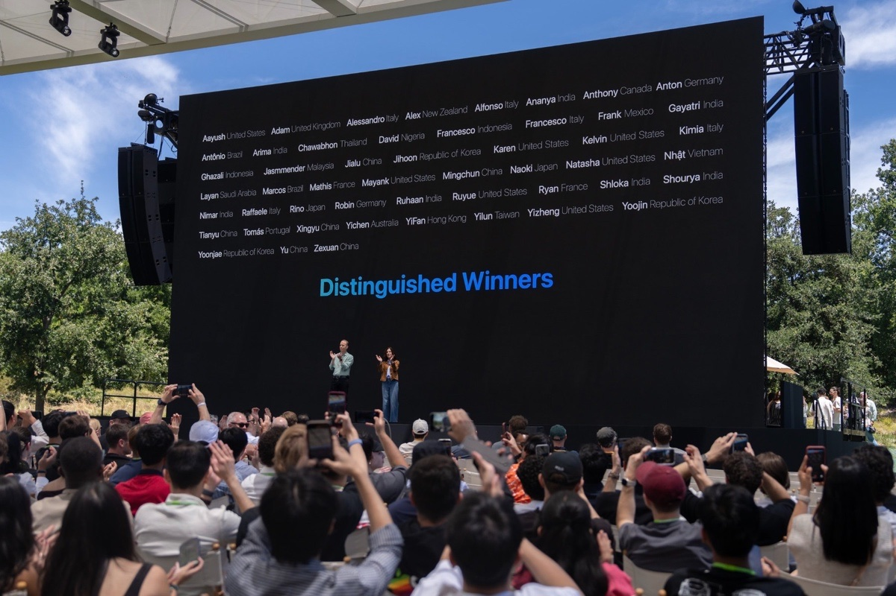
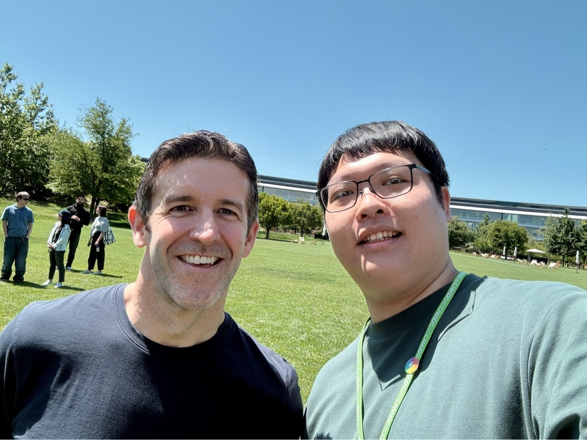

# SSC26 Story (Part 2): Becoming a Distinguished Winner and Experiencing WWDC26

> This is the second part of my SSC26 story. If you'd like to know how ReMinder came to life, start with [Part 1](/stories/ssc26-reminder-part-1). Here, I'll share what it was like to find out I'd won, my experiences at WWDC26, and a few things I'd like to say to anyone thinking about entering the challenge.

## The Moment I Found Out I'd Won

All I can say about the moment I found out I'd won is that I completely lost my mind.

On the morning of March 27, I eagerly opened my inbox, but there was no email announcing the results. My heart sank. Feeling nervous, I decided to check Apple's website directly. To my surprise, the moment I signed in, I saw a big "Congratulations!" on the screen—and somehow, my heart sank even further.

You see, based on my research beforehand (haha), Distinguished Winners in previous years had seen a page headed "You did it!" rather than "Congratulations." So at that moment, I assumed I'd only been selected as a regular Winner.

Then, while my eyes were still barely open that early in the morning, I scrolled down a little further and suddenly realized... AHHH!!! I WAS A DISTINGUISHED WINNER!!!

I literally jumped out of bed and excitedly messaged my parents with the news. My reaction was so intense that, for a moment, they thought I'd been scammed or that something had happened to me.

Everything that morning felt completely unreal. At one point, I even wondered whether there was something wrong with Apple's website—what if everyone who signed in was being shown "Distinguished Winner"? And that feeling of disbelief didn't disappear after I'd confirmed the result. Even after booking my flight to the United States that same day, and even on the day before I left, I still found the whole thing hard to believe.

I'd entered the competition simply wanting to give it a try. I never imagined I'd become a Distinguished Winner, let alone have the chance to travel to the United States. I couldn't believe I might actually get to see the Apple Park spaceship I'd only ever admired in photos and videos, or meet people I'd previously seen only in Apple presentations. On top of that, 2026 happened to be Apple's 50th anniversary, with a CEO transition as well. It felt as though this trip was destined to be full of unforgettable memories.

## About WWDC26

I have to say, the energy and enthusiasm at WWDC were absolutely unbelievable. To put it jokingly, I can see why some people say that Dub Dub is practically a cult (haha).

During those three days at Apple Park, I genuinely couldn't stop smiling. For me, it was a funny contradiction. On the one hand, I felt a kind of pure happiness that came straight from the heart. It was a dream come true, and I kept wondering whether I was dreaming. On the other hand, I'm a very introverted person, so I was constantly debating whether I should just let myself grin like a happy little puppy.

Eventually, the argument I kept using to convince myself was this: I might only get to experience the DW Experience once in my life. Since I was already there, why not let myself smile like an idiot? Why not make some small talk?

That experience also changed what I hoped to get out of conferences in the future. I began wanting to meet more people, make friends, and exchange ideas. Even just getting the chance to meet someone I'd once thought I could only admire from afar felt completely worthwhile.

### Everyone Came With Their Own Story

As for the other winning students I met, all I can say is: every single one of them was incredibly talented! One of the things I learned from them was that almost any subject can become the starting point for a Swift Student Challenge submission. For example:

- Someone built an interactive game that teaches people how to create strong passwords.
- Someone designed an app for creating mandalas using drawing, gestures, and sound.
- Someone used AirPods and on-device AI to help people practice public speaking.
- Someone created an immersive Apple Vision Pro experience that lets people explore local culture beneath the stars by Lake Takapō in New Zealand.
- There were also games teaching children about type 1 diabetes, apps using hand tracking and real-time feedback to teach American Sign Language, tools helping night-shift workers assess their alertness before driving, experiences for making personalized daruma dolls, and interactive stories about AI.

These projects made me realize how many people outside my own little world were bringing their personal stories to the challenge—and being recognized for them.

I also noticed something important: almost all of their projects had a strong connection to their everyday lives. Behind each one was often a story involving the creator's family, interests, expertise, or even their country and culture.

It made me believe even more strongly that an idea doesn't have to come from some incredibly complex technology or grand ambition. Sometimes, an ordinary experience from your own life is already a great place to start.

### For Fellow Introverts: Try Taking the First Step

Another thing this experience taught me, as an introvert, was how important it can be to find the courage to step outside your comfort zone and start a conversation. If I hadn't tried talking to other people, I might never have heard so many amazing stories.

Speaking of which, there's a pretty funny story I want to share.

On the first morning of the DW Experience, Apple had arranged an icebreaker session. There were some tables for individuals and others for groups. Naturally, being the introvert I am, I chose a table for one without hesitation.

Later, an Apple employee came over to check on me. I took the opportunity to ask who the people sitting at the other individual tables were. I figured that if they were students too, it might be easier to start a one-on-one conversation.

Well... it turned out that the individual tables were for parents. All the students were sitting at the group tables. I was so embarrassed.

Thankfully, I eventually found a few students to chat with, and that's how my first conversations began. As I met more and more people, I gradually grew braver. I also started to realize just how friendly everyone at WWDC was, and how willing they were to talk and share their experiences.

I'm sharing this little story because I want to encourage more people to give networking a try. Especially if you're someone like me who doesn't naturally feel comfortable starting conversations, here's what I'd like to say: you don't have to be good at socializing from the beginning, and you don't have to force yourself to become an extrovert. Just being willing to take that first step might lead you to stories you'd never otherwise hear.

If you're planning to attend WWDC27, I also strongly recommend looking for in-person events you can join. So many of the wonderful stories and genuinely meaningful conversations I experienced happened at those gatherings. You never know—there might be an unexpected surprise waiting for you!

### So What Exactly Is the DW Experience?

By now, I imagine a lot of people are curious about the DW Experience I've mentioned so many times. All I can say is that it was genuinely dreamlike! Getting a photo with the CEO, taking part in special events—yes, those things really happened.

But in the spirit of Apple's own secrecy at the time, I think I'll keep the specific details of the experience to myself (hahaha).

In broader terms, you have the chance to take photos with and speak to people you normally only see in keynote videos. You can share your work with Apple employees and hear their feedback and encouragement. Beyond that, there's the almost overwhelming enthusiasm, the applause and cheering, the chance to meet Distinguished Winners from all over the world, the special group activities Apple organizes and leads, and the kind of expanded perspective that money simply can't buy.

Really, everything was so dreamlike and so mind-blowing. Even now, looking back on it, I still find it hard to believe it all actually happened to me.

As for just how incredible the DW Experience really is, I'll leave that for the people who get to experience it in the future to discover for themselves. Let's just say we even joked that it was the GOAT—Greatest Of All Time!

## Finally, There Are a Few Things I'd Like to Say...

Just like I did back then (and maybe still do now, haha), I think a lot of students see the Swift Student Challenge as something far beyond their reach. So before I finish, there are a few thoughts I'd like to share.

### Tell Your Story

First, I don't think you have to start by asking yourself how to build something incredibly impressive or technically complex.

There's a line I really like from Jia Chen Yee, the host of Swift Student Cafe:

> Tell your story. Make stupid things. Change YOUR world.

It reminds me that some of the most unexpected creative ideas come from the tiny things around us—things that seem insignificant, or that we wouldn't normally give a second thought.

You might create something you absolutely love that hardly anyone notices. Or you might make something you're not entirely happy with, only to find that other people appreciate it more than you expected.

But regardless of the outcome, these projects all have something in common: they come from your story, your own two hands, and the world you want to change—your world.

So instead of beginning with the enormous goal of "I want to build something that changes the world," why not start by thinking about what you genuinely care about, what you really want to solve, or what you've always wanted to tell others?

Who knows? The next world-changing idea might already be somewhere in your head!

### No Mac? Never Learned Swift? GO FOR IT!

I also want to encourage students who don't have a Mac, or who have never learned Swift and are wondering whether they should enter the challenge:

**GO FOR IT!**

As someone who made it all the way through the competition with an iPad, I feel that the idea of "Everyone Can Code" really can become a reality—at least in this challenge.

Use the device you're comfortable with. Have a conversation with the AI tools you already use. And just get started!

But as I mentioned in [Part 1](/stories/ssc26-reminder-part-1), while AI can help you write code and solve problems, you still have to keep thinking and deciding for yourself what you want your work to communicate, how people should experience it, and why one design approach makes more sense than another.

For me, that was also the most interesting—and most challenging—part of the whole development process.

### Participating Is an Achievement in Itself

As for winning, I genuinely never imagined I'd be selected as a Distinguished Winner.

Apple Park had always been a dream destination for me, but with only 50 spots worldwide, the odds felt unbelievably small. Even now, when I talk about the experience, it still feels a little like a dream. If it weren't for the souvenirs I brought home constantly reminding me that I'd really been there, I might honestly believe it was all just one beautiful dream.

I also strongly agree with a line from the Swift Student Challenge 2027 website:

> Participating in the Swift Student Challenge is an achievement in itself.

Because I think that even if ReMinder hadn't won, I would probably still have been happy—though of course I'd have felt disappointed about missing out on an award.

After all, I'd gone from knowing absolutely nothing about Swift to successfully creating my very first app, and I'd even gone on to publish it on the App Store.

More than that, ReMinder finally gave me the chance to express stories I'd long wanted to share—things I'd wanted to do or tell other people about in my everyday life, but had never had the chance or time to put into words properly.

That alone was already a real achievement for me.

Of course, winning the award, getting to visit Apple Park, and making friends from so many different parts of the world were all incredibly precious experiences that went far beyond anything I'd originally imagined.

But the reason I'm sharing all of this is that I hope you won't give up the chance to try just because you're worried you might not win.

If there's an app you've always wanted to make, an experience you've always wanted to share, or a story you've always wanted to tell, I really encourage you to build it and take the leap of submitting it!

And as for what might happen in the end...

Well, I don't think the person who once contacted Apple Support just to ask whether there was a free Developer account for students could ever have imagined that one day, he'd actually walk into Apple Park.

***

[Try ReMinder on the App Store](https://apps.apple.com/app/reminder-edition/id6790437560)
