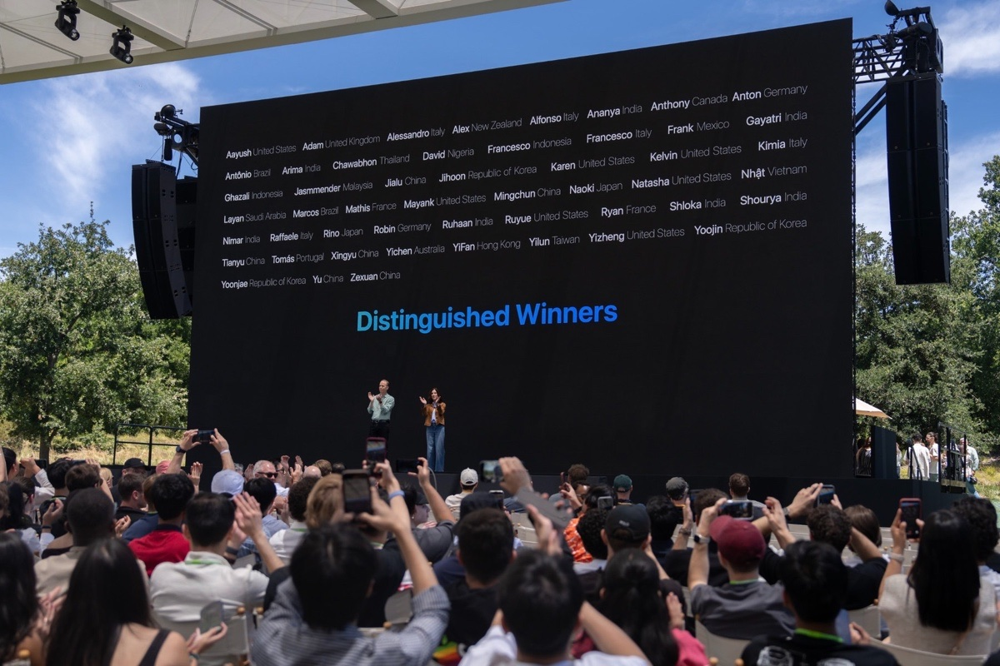
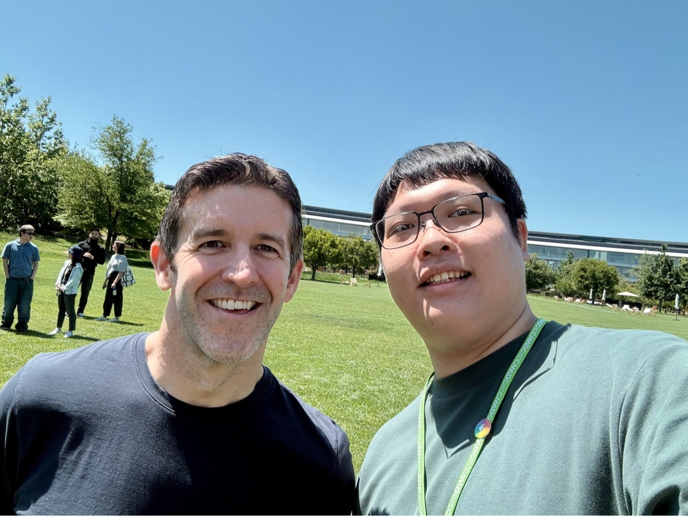

# SSC26 分享（下）：成為 Distinguished Winner 與 WWDC26

> 這是 SSC26 分享的下篇。ReMinder 這個作品是怎麼做出來的，可以先看[上篇](/stories/ssc26-reminder-part-1)；這篇要聊的是得獎那一刻、WWDC26 的經歷，以及我想對準備參賽的你說的話。

## 關於得知獲獎的那一刻

至於得知獲獎的那一刻，我只能說，我當下真的快瘋掉了。

3 月 27 日當天早上，我期待地打開信箱，卻沒有看到任何通知比賽結果的 Email，當下心就已經涼了一半。於是，我抱著忐忑的心情，決定直接打開 Apple 的網站查看結果，沒想到一登入就看到大大的「Congratulations!」，我的心反而更涼了。

因為根據我事前的調查（笑），往年的 Distinguished Winner 在查看結果時，頁面上會出現「You did it!」的標題，而不是 Congratulations，所以當下我還以為，自己應該只是一般的 Winner 了。

結果，就在我一大早眼睛都還沒完全睜開的時候，繼續往下滑，才突然發現……啊！！！我是 Distinguished Winner！！！我當場從床上跳起來，興奮地傳訊息告訴爸媽這個消息，結果他們看到我的反應，甚至一度以為我是不是遇到詐騙，還是發生了什麼事情。

那天早上的一切真的非常不真實，我甚至一度懷疑，是不是 Apple 的網站出了什麼問題，搞不好所有人登入之後都會顯示 Distinguished Winner？而這種難以置信的感覺，並沒有在確認結果後就消失。即使當天已經訂好了前往美國的機票，甚至直到出國前一天，我都還是覺得整件事情有點不可思議。

畢竟，從一開始只是抱著試試看的心情參加比賽，到後來真的獲得 Distinguished Winner，甚至有機會親自前往美國，這些都是當初準備作品時完全不敢想像的事情。我真的很難以置信，自己竟然有機會親眼看看那艘一直以來只在照片和影片中見過、夢想中的 Apple 大飛船，還有那些以前只能透過發表會看到的人物。更何況，2026 年剛好是 Apple 創立 50 週年，又碰上 CEO 交接，感覺這趟旅程註定會有很多難忘的回憶。

## 關於 WWDC26

我必須說，在 WWDC 體驗到的熱情與活力，真的超級誇張。用比較調侃的說法來講，也難怪很多人會說 Dub Dub 根本是邪教（笑）。

在 Apple Park 的那三天，我的嘴角是真的壓不下來。對我自己來說，這其實還蠻矛盾的：一方面，我強烈地感受到一種發自內心的開心，覺得這一切簡直是夢想成真，甚至忍不住懷疑自己是不是在做夢；但另一方面，我又是一個很內向的人，所以一直處於反覆思考「我到底要不要笑得像隻快樂小狗」的邊緣。

後來，我最常拿來說服自己的理由，就是這一生可能只有這麼一次 DW Experience，既然都來了，要傻笑就傻笑，要 Small Talk 就 Small Talk 吧！而這段經歷，也大大改變了我後來對於參加研討會的期待。我開始希望自己能夠認識更多人、交朋友、交換想法，即使只是去朝聖某個以前想都不敢想、只能遠遠仰望的人，我也覺得很值得。

### 每個人都帶著自己的故事來

說到這次遇見的其他得獎學生，我只能說，真的每個人都好厲害！我從他們身上學到的一件事，就是原來任何題材，都有可能成為 Swift Student Challenge 的作品來源。舉例來說：

- 有人透過互動遊戲，教導使用者建立強密碼
- 有人設計了能透過繪畫、手勢與聲音創作曼陀羅的 App
- 有人運用 AirPods 與裝置端 AI，協助使用者練習公開演說
- 有人為 Apple Vision Pro 打造沉浸式體驗，讓使用者置身紐西蘭的 Takapō 湖畔，在星空下探索當地文化
- 此外，還有教導兒童認識第一型糖尿病的遊戲、透過手部追蹤與即時回饋學習美式手語的 App、協助夜班工作者評估開車前警覺程度的工具，以及讓使用者製作專屬達摩、透過互動故事學習 AI 知識的作品等等

這些作品讓我發現，原來在我的視野之外，還有這麼多人帶著屬於自己的故事來參賽，並且獲得肯定。而且，我也從這些人身上觀察到一件非常重要的事情：他們的作品幾乎都和自己的生活有著非常強烈的關聯性，每個故事背後，都可能連結著創作者的家人、興趣、專業，甚至是自己的國家與文化。這也讓我更加相信，作品的靈感其實不一定要來自多麼複雜的技術或宏大的題目，有時候，自己生活中那些看似平凡的經驗，就已經是很好的起點。

### 給內向的你：試著踏出第一步

另一方面，對於像我這樣內向的人來說，這次經驗也讓我體會到，鼓起勇氣踏出舒適圈、主動和別人交流，真的很重要。因為如果當初沒有試著和其他人聊天，我可能就沒有機會聽到這麼多精彩的故事。

說到這裡，我還有一個很好笑的小故事。

在 DW Experience 的第一天早上，Apple 安排了一段破冰時間。當時場地裡有幾張單人桌和多人桌，而身為內向人的我，毫不猶豫地選擇了單人桌。後來，有位 Apple 員工過來關心我，我就順勢問他，坐在隔壁其他單人桌的人是誰，因為我想說，如果也是其他學生的話，一對一聊天應該比較容易開頭。

結果……單人桌坐的是家長，學生都在多人桌，我超尷尬的。

好在後來還是有順利找到幾位願意一起聊天的同學，也就這樣展開了我的第一次對話。而且，隨著認識的人越來越多，我也開始越挫越勇，慢慢發現 WWDC 的大家真的都超級友善，也很願意聊天、分享自己的經驗。

之所以特別分享這段故事，也是希望能鼓勵更多人勇敢嘗試 Networking。尤其是對那些和我一樣，原本不太敢主動開口的人來說，我想告訴你：其實不用一開始就很擅長社交，也不用強迫自己變成外向的人，只要願意試著踏出第一步，就可能聽見很多意想不到的故事。

如果你打算參加 WWDC27，我也非常推薦你一定要找找看有沒有可以參加的線下活動。因為這次有很多精彩的故事，以及真正深入的交流，都是在線下活動中發生的。我只能說，也許會有意想不到的驚喜也說不定！

### 那 DW Experience 到底是什麼？

說到這裡，我相信很多人最好奇的，應該還是我前面提到好多次的 DW Experience 到底是什麼？我只能說，這真的太夢幻了！和 CEO 合照、參加特別活動，這些都是真的。

不過，就和當時的 Apple 一樣守口如瓶，我想我還是把體驗的具體內容保密好了（哈哈哈）。如果要用比較概括的方式來形容：你真的有機會和那些平常只會在發表會影片裡看到的大人物拍照、說話，也能向 Apple 員工分享自己的作品，聽到他們的回饋與鼓勵；除此之外，還有近乎瘋狂的熱情、掌聲與歡呼，認識來自世界各地的 Distinguished Winners，參與 Apple 特別安排和主持的小組活動，以及那種難以用金錢衡量的眼界拓展。真的，一切都太夢幻、太 Mind-Blowing 了！直到現在回想起來，我還是會覺得，這一切竟然真的發生在自己身上。

至於 DW Experience 究竟有多誇張，我想就留給未來有機會參加的人親自體驗吧！只能說，我們甚至開玩笑稱這根本就是 GOAT（Greatest Of All Time）！

## 最後，我有一些話想說⋯

就和當初的我一樣（也許現在還是一樣啦哈哈），相信很多人都覺得 Swift Student Challenge 是一個很難觸及的挑戰賽，所以在文章的最後，我也有一些想法想和大家分享。

### Tell your story

首先，我認為不一定要從「如何做出一個很厲害、很複雜的作品」開始思考。我很喜歡 Swift Student Cafe 主持人 Jia Chen Yee 說過的一句話：

> Tell your story. Make stupid things. Change YOUR world.

這句話讓我想到，很多意想不到的創意，其實都來自我們身邊那些看似微不足道，甚至平常根本不會特別注意的事情。你可能做出一個自己非常喜歡，卻沒有被太多人看見的作品；也可能做出一個自己不太滿意，卻意外受到他人肯定的作品。但不論結果如何，這些作品都有一個共同點：它們來自你的故事、你的雙手，以及你想改變的、屬於自己的世界。

所以，我認為與其一開始就設定「我要做出一個改變世界的作品」這麼宏大的目標，不如先想想，有沒有什麼事情是你真的很在意、很想解決，或是一直想告訴別人的呢？也許，下一個改變世界的想法，就藏在你的腦袋裡也說不定！

### 沒有 Mac、不會 Swift？GO FOR IT！

另一方面，我也想鼓勵那些身邊沒有 Mac 電腦，或是從來沒有學過 Swift，因此正在猶豫要不要參賽的學生：

**GO FOR IT！**

身為一個帶著 iPad 一路走進比賽的參賽者，我想，「人人都能程式設計」這個理念，至少在這場比賽中，是真的可以實現的。使用你順手的設備，和你平常習慣使用的人工智慧工具聊聊天，就這樣開始吧！

不過，就像我在[上篇](/stories/ssc26-reminder-part-1)提到的，AI 可以協助寫程式、解決問題，但作品究竟想傳達什麼、使用者應該如何體驗，以及為什麼要採用某種設計，這些仍然需要由創作者自己不斷思考和決定。而對我來說，這也是整個開發過程中最有趣、最有挑戰性的部分。

### 參賽本身，就是一種成就

至於得獎，我只能說，我真的從來沒想過自己能夠獲得 Distinguished Winner。雖然 Apple Park 一直是我夢想中的朝聖地點，但全球只有 50 個名額，真的太少、太少了，以至於直到現在，說起這段經歷，我都還是覺得有點如夢似幻。如果不是有當時帶回來的紀念品，不斷提醒我自己真的去過那裡，我可能真的會以為，這一切只是一場很美的夢。

我也非常認同 Swift Student Challenge 2027 官網上的一句話：

> Participating in the Swift Student Challenge is an achievement in itself.

因為我想，如果今天 ReMinder 沒有得獎，雖然可能會因為和獎項擦身而過而感到失望，但我應該還是會很開心吧！畢竟，我真的從一個完全不會 Swift 的人，成功打造出自己的第一個 App，後來甚至還把它上架到了 App Store。

除此之外，我也終於透過 ReMinder，表達了那些自己在生活中一直想做、想告訴別人，卻始終沒有機會，或是沒有時間好好說出來的故事。光是這樣，對我而言，就已經是一件很有成就感的事情了。

當然，能夠獲獎、前往 Apple Park，甚至認識這麼多來自世界各地的朋友，都是非常珍貴，而且完全超出我原本想像的經歷。但我之所以分享這些，也是希望大家不要因為擔心自己無法得獎，就放棄嘗試的機會。如果你有一個一直想做的 App、一段一直想分享的體驗，或是一個一直想告訴別人的故事，我真的很推薦你試著把它做出來，然後勇敢投稿！

至於最後會發生什麼事情……

我想，當初那個只是跑去問 Apple 客服，有沒有免費 Developer 帳號可以領的人，應該也完全沒想過，自己有一天竟然真的會走進 Apple Park 吧。

***

[前往 App Store 體驗 ReMinder](https://apps.apple.com/tw/app/reminder-edition/id6790437560)
